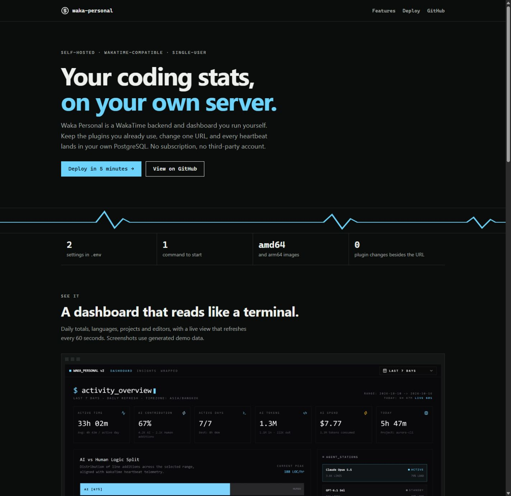
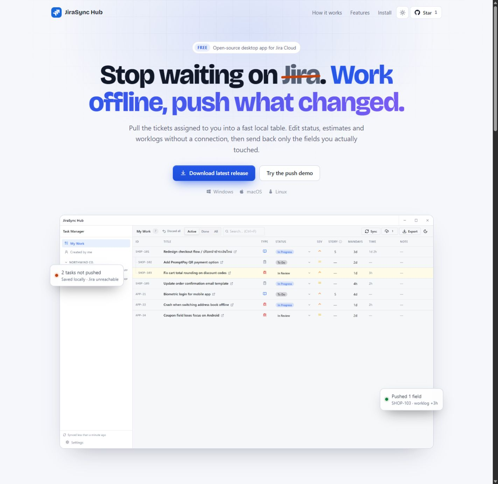
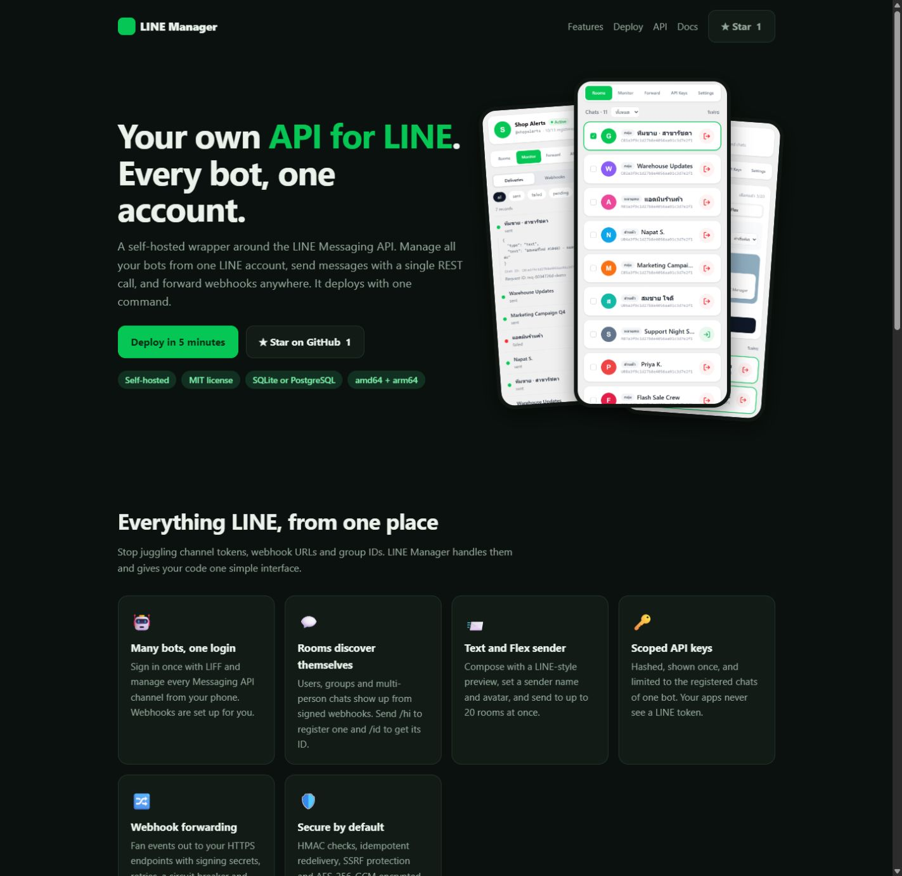
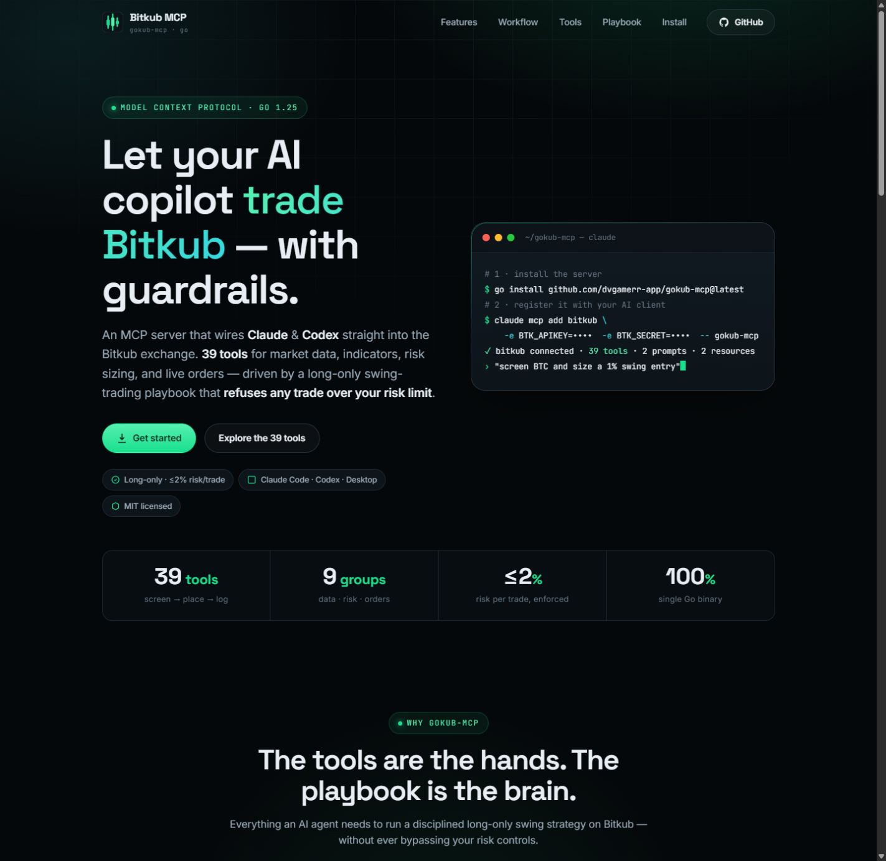

<a href="https://dvgamerr.app/"></a>

<p align="center">
<a href="https://dvgamerr.app/"></a>
<a href="https://github.com/dvgamerr-app"></a>
<a href="https://fastwork.com/user/cotrts"></a>
<a href="mailto:kananek@dvgamerr.app"></a>
</p>

I turn “can we automate this?” into another repo. Sometimes an entire platform. 😅

Currently **Technical Lead at SCG WEDO**, building AI systems and the APIs, pipelines, and infrastructure that keep them alive. Previously **Central Group / RIS** and **Nippon Sysits**. Still happiest when a messy problem turns into a small tool somebody actually uses.

```ts
const kem = {
  handle: "dvgamerr",
  location: "Bangkok, TH",
  builds: ["agentic AI", "web + desktop apps", "APIs", "data pipelines"],
  shipsWith: ["Go", "Python", "TypeScript", "Docker", "Kubernetes"],
  rabbitHoles: ["multi-agent systems", "GitOps", "homelab", "game utilities"],
  defaultResponse: "there's probably a way to script that",
};
```

### 🧪 escaped from localhost

Real projects. Real websites. A few of the reasons my repo count keeps going up.

<table>
<tr>
<td width="50%" valign="top">
<h3>⌁ Waka Personal</h3>
<a href="https://dvgamerr.app/waka-personal/"></a>
<p>Your coding history, on your own server. WakaTime-compatible backend + dashboard. Keep the plugins; own the data.</p>
<p><code>Go</code> <code>PostgreSQL</code> <code>Astro</code> <code>React</code></p>
<a href="https://github.com/dvgamerr-app/waka-personal">source ↗</a> · <a href="https://dvgamerr.app/waka-personal/">website ↗</a>
</td>
<td width="50%" valign="top">
<h3>⇄ JiraSync Hub</h3>
<a href="https://dvgamerr.app/jirasync-hub-app/"></a>
<p>Jira without the constant waiting. Edit tickets and worklogs offline, then push only what changed.</p>
<p><code>Offline-first</code> <code>Desktop</code> <code>Jira Cloud</code></p>
<a href="https://github.com/dvgamerr-app/jirasync-hub-app">source ↗</a> · <a href="https://dvgamerr.app/jirasync-hub-app/">website + demo ↗</a>
</td>
</tr>
<tr>
<td width="50%" valign="top">
<h3>↗ LINE Manager</h3>
<a href="https://dvgamerr.app/notice-manager/"></a>
<p>Multiple LINE bots, one place to manage them. REST messaging, webhook forwarding, and a Docker Compose deployment.</p>
<p><code>Automation</code> <code>Webhooks</code> <code>Self-hosted</code></p>
<a href="https://github.com/dvgamerr-app/notice-manager">source ↗</a> · <a href="https://dvgamerr.app/notice-manager/">website ↗</a>
</td>
<td width="50%" valign="top">
<h3>⚡ gokub-mcp</h3>
<a href="https://dvgamerr.app/gokub-mcp/"></a>
<p>Give your AI client tools to work with Bitkub. A Go MCP server for market data and exchange workflows.</p>
<p><code>Go</code> <code>MCP</code> <code>AI tools</code></p>
<a href="https://github.com/dvgamerr-app/gokub-mcp">source ↗</a> · <a href="https://dvgamerr.app/gokub-mcp/">website ↗</a>
</td>
</tr>
</table>

<sub>Captured from the live product websites. Dashboard previews on those pages may use demo data.</sub>

### 🧰 also in the toolbox

- **[Live Paper](https://github.com/dvgamerr-app/livepaper-app)** — wallpapers per monitor, video behind your desktop icons. [See it](https://dvgamerr.app/livepaper-app/).
- **[Nimbus Markdown](https://github.com/dvgamerr-app/nimbus-markdown)** — Markdown + fullscreen Mermaid pan/zoom, based on simov/markdown-viewer. [Install it](https://chromewebstore.google.com/detail/nimbus-markdown/kbkjbpmegfjbnpkdmlelkemmolegipkk).
- **[go-hoyolab](https://github.com/dvgamerr-app/go-hoyolab)** — let a bot remember your HoYoLAB daily check-ins. [Set it up](https://dvgamerr.app/go-hoyolab/).
- **[go-bitkub](https://github.com/dvgamerr-app/go-bitkub)** — Go SDK + CLI, WebSocket streams, request signing. [Docs & examples](https://dvgamerr.app/go-bitkub/).
- **[Cinema Scraper](https://github.com/dvgamerr/etl-cinema-scraper)** — Major + SF movie listings → structured JSON. Bun, Puppeteer, and fewer manual clicks.
- **[dvgamerr.app](https://github.com/dvgamerr-app/dvgamerr-app.github.io)** — a resume that somehow grew a 3D globe. [Take a look](https://dvgamerr.app/).

### 🧠 current brain cache

<p>


</p>

```text
user idea
   ├── UI          Astro · Svelte · Vue · React
   ├── agents      LangGraph · LangChain · LiteLLM · MCP
   ├── services    Go · Python · FastAPI · Bun · Elysia
   ├── data        PostgreSQL · Redis · ETL · SQL / NoSQL
   └── production  Kubernetes · Argo CD · CI/CD · logs that help
```

<details>
<summary><strong>expand the stack / there's more in here</strong></summary>

- **Languages:** Go, Python, TypeScript, JavaScript, C, C#, C++, Java, Kotlin, Swift, Objective-C, Dart, PHP, Ruby, Rust, PowerShell, Shell.
- **Web & apps:** Astro, Svelte, Vue, React, HTML, CSS, SCSS, WordPress, Windows and Android development.
- **AI & integration:** FastAPI, LangGraph, LangChain, LiteLLM, MCP, Node.js, Bun, Elysia, KrakenD Enterprise, MuleSoft, SnapLogic, LINE.
- **Data:** PostgreSQL, MySQL, SQL Server, Oracle, MongoDB, Redis, SQLite, InfluxDB, Elasticsearch.
- **Platform:** AWS, Azure, Google Cloud, Docker, Kubernetes, AKS, K0s, K3s, Helm, Argo CD, GitHub Actions, GitLab CI/CD, GoCD, Linux, Windows Server.
- **Observability:** Fluent Bit, ClickHouse, Promtail, Loki, health checks and centralized logging.

Different tools, different projects, different levels of battle scars. [The full story lives here](https://dvgamerr.app/#experience).

</details>

### 📡 activity feed

<a href="https://github.com/dvgamerr"></a>

<p align="center">
<a href="https://wakatime.com/@dvgamerr"></a>
</p>

<p align="center"><samp>if i do it twice, the third time is probably a script.</samp></p>