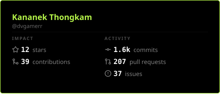

# Hey, I'm KEM 👋

**Kananek Thongkam · Technical Lead Software Engineer · Bangkok, Thailand**

I build things from the first sketch to production: web and desktop apps, AI agents, APIs, data pipelines, and the infrastructure behind them. Currently at **SCG WEDO (Digital Office)**, with previous experience at **Central Group / RIS** and **Nippon Sysits**.

I like tools that save a few clicks, cut repetitive work, or make a complicated system easier to live with. Most of my public projects are at [**dvgamerr-app**](https://github.com/dvgamerr-app).

[Portfolio & resume](https://dvgamerr.app/) · [Open source](https://github.com/dvgamerr-app) · [Fastwork](https://fastwork.com/user/cotrts) · [Email](mailto:kananek@dvgamerr.app)

## What I work on

| Area | What that looks like |
| --- | --- |
| **AI & agent systems** | Multi-agent orchestration, tool calling, streaming chat, document processing, multi-model integration, and observability. FastAPI, LangGraph, LangChain, LiteLLM, and MCP. |
| **Full-stack & apps** | Websites, dashboards, back-office tools, Windows apps, Android apps, and CLIs. Astro, Svelte, Vue, React, Go, Bun, and Elysia. |
| **APIs & integration** | Microservices, API aggregation, gateways, webhooks, SDKs, and messaging workflows. KrakenD Enterprise, MuleSoft, SnapLogic, and LINE. |
| **Data engineering** | ETL engines, scraping, data migration, database design, and pipelines that turn scattered data into something useful. |
| **Cloud & platform** | Docker, Kubernetes, Helm, Argo CD, GitOps, CI/CD, logging, and multi-environment deployments across cloud and self-hosted systems. |
| **Technical leadership** | Architecture reviews, technology choices, engineering standards, developer tooling, and helping teams ship and maintain their systems. |

## Things you can try

Public projects, with source code and product pages where available.

| Project | Why I built it | Links |
| --- | --- | --- |
| **Waka Personal** | A self-hosted WakaTime-compatible backend and coding dashboard. Keep your editor plugins and own your coding history. | [Code](https://github.com/dvgamerr-app/waka-personal) · [Website](https://dvgamerr.app/waka-personal/) |
| **JiraSync Hub** | An offline-first Jira desktop app. Edit tickets and worklogs locally, then push only the fields you changed. | [Code](https://github.com/dvgamerr-app/jirasync-hub-app) · [Website & demo](https://dvgamerr.app/jirasync-hub-app/) |
| **LINE Manager** | Manage LINE bots from one account, send messages through a REST API, and forward webhooks. Self-host with Docker Compose. | [Code](https://github.com/dvgamerr-app/notice-manager) · [Website](https://dvgamerr.app/notice-manager/) |
| **Live Paper** | Per-monitor wallpapers and live video on Windows, with a tray app and CLI. | [Code](https://github.com/dvgamerr-app/livepaper-app) · [Website](https://dvgamerr.app/livepaper-app/) |
| **gokub-mcp** | A Go MCP server connecting AI clients to Bitkub tools and market data. | [Code](https://github.com/dvgamerr-app/gokub-mcp) · [Website](https://dvgamerr.app/gokub-mcp/) |
| **go-bitkub** | A Go SDK and CLI for Bitkub, including WebSocket streams and request signing. | [Code](https://github.com/dvgamerr-app/go-bitkub) · [Website](https://dvgamerr.app/go-bitkub/) |
| **go-hoyolab** | Daily HoYoLAB check-ins for Genshin, Honkai Impact 3rd, Star Rail, and ZZZ. One less daily chore. | [Code](https://github.com/dvgamerr-app/go-hoyolab) · [Website](https://dvgamerr.app/go-hoyolab/) |
| **Nimbus Markdown** | A browser Markdown viewer based on simov/markdown-viewer, with a table of contents and fullscreen Mermaid pan/zoom. | [Code](https://github.com/dvgamerr-app/nimbus-markdown) · [Chrome Web Store](https://chromewebstore.google.com/detail/nimbus-markdown/kbkjbpmegfjbnpkdmlelkemmolegipkk) |
| **Cinema Scraper** | Collect movie listings from Major Cineplex and SF CinemaCity into structured JSON with Bun and Puppeteer. | [Code](https://github.com/dvgamerr/etl-cinema-scraper) |
| **dvgamerr.app** | My bilingual portfolio and resume, with a 3D globe and coding activity visualizations. | [Code](https://github.com/dvgamerr-app/dvgamerr-app.github.io) · [Website](https://dvgamerr.app/) |

## Experience behind the projects

- **SCG WEDO · Technical Lead Software Engineer** — September 2026–present. Architecture, engineering standards, developer productivity, and team practices.
- **SCG WEDO · Software Engineer / Technology Developer** — October 2022–September 2026. SCG Home AI Service (Homie), agentic chat UI, enterprise API gateways, integration platforms, GitOps, and centralized logging.
- **Central Group / RIS · Senior Full Stack Engineer** — January 2019–October 2022. Go APIs, Azure PostgreSQL / AKS, Kubernetes, notification services, and a Go ETL engine replacing Talend for datasets around 200 GB.
- **Central Group / RIS · Senior Development Assistant Division Manager** — January 2018–February 2019. Developer tools, CI/CD, LINE workflows, booking, and POS integrations.
- **Nippon Sysits · Full Stack Developer** — April 2013–December 2018. Web and payment systems, Windows / Android apps, server and database operations, and R&D with OpenCV and Arduino.
- **Freelance · Programmer** — April 2011–April 2013. PHP / WordPress websites, custom themes and plugins, integrations, documentation, and client handovers.

[Full work history and education →](https://dvgamerr.app/#experience)

<strong>Languages, databases & tools I've worked with</strong>

These span different roles and projects; they aren't a claim of equal depth in every technology.

| Category | Technologies |
| --- | --- |
| **Languages** | Go, Python, TypeScript, JavaScript, C, C#, C++, Java, Kotlin, Swift, Objective-C, Dart, PHP, Ruby, Rust, PowerShell, Shell |
| **Web** | Astro, Svelte, Vue, React, HTML, CSS, SCSS, WordPress |
| **AI & backend** | FastAPI, LangGraph, LangChain, LiteLLM, MCP, Node.js, Bun, Elysia, KrakenD, MuleSoft, SnapLogic |
| **SQL & NoSQL** | PostgreSQL, MySQL, SQL Server, Oracle, MongoDB, Redis, SQLite, InfluxDB, Elasticsearch |
| **Cloud & delivery** | AWS, Azure, Google Cloud, Docker, Kubernetes, AKS, K0s, K3s, Helm, Argo CD, GitHub Actions, GitLab CI/CD, GoCD, Linux, Windows Server |
| **Observability** | Fluent Bit, ClickHouse, Promtail, Loki, health checks, and logging pipelines |
| **Daily tools** | Git, GitHub, GitLab, Postman, Insomnia, Anypoint Studio, Android Studio, Visual Studio, VS Code, Jira, Confluence, Teleport, TablePlus, DBeaver, SQL Server Management Studio |

## Around here

Away from enterprise systems, I'm usually tinkering with my homelab, building another small utility, or making a game-related task a little less manual.

If you're working on an AI workflow, a difficult integration, or a tool that should already exist, [let's talk](mailto:kananek@dvgamerr.app).
